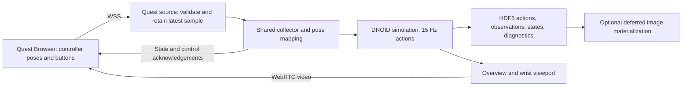

# Meta Quest 3S Demonstration Collection Plan

Date: 2026-09-18

Status: Proposed; repository inspection and platform documentation review only. Quest hardware, browser streaming, and latency have not been tested.

**Recommendation:** Add a Quest Browser WebXR client and a `quest` backend to the existing teleoperation collector. Run simulation, IK, and recording on the RoboLab server. Start with one Touch Plus controller controlling the simulated DROID arm and an overview/wrist video panel inside the headset.

The assumed first deliverable is successful simulated task demonstrations in RoboLab's existing HDF5 format. Controller-free hands, physical robots, dual-arm control, and a stereoscopic scene that follows head motion are later extensions. This scope is a planning assumption, not a confirmed hardware requirement.

## Existing integration points

| Component | Observed behavior and planned reuse |
| --- | --- |
| [Shared collector](../robolab/core/teleop/collector.py) | Already supports keyboard and SO-101 entry points, one simulated DROID, success counting, failure export, pacing, cleanup, and deferred images. Backend selection still contains SO-101-specific branches. |
| [Pose retargeter](../robolab/core/teleop/retarget.py) | Provides anchored targets, orientation following, filtering, workspace/step limits, gripper hysteresis, and tracking-error pauses. It still reads `joints_deg` even in ordinary pose mode; Quest cannot simply supply a pose to it unchanged. |
| [Lifecycle](../robolab/core/teleop/lifecycle.py), [controller](../robolab/core/teleop/so101_controller.py), [runtime](../robolab/core/teleop/so101_runtime.py) | Provide explicit starts, clutching, stale-input pauses, re-anchoring, and per-step diagnostics. Extract the shared behavior while preserving SO-101 operation. |
| [SO-101 source](../robolab/core/teleop/so101_source.py) | Assumes a local helper, joint readings, and the same host monotonic clock. Add a separate network source for Quest. |
| [DROID actions](../robolab/robots/droid.py), [registration](../robolab/registrations/droid/auto_env_registrations_rel_ik.py) | Relative IK controls gripper mount `base_link`, with identity body offset and scalar action scale `0.5`. Physics is 120 Hz, decimation is eight, and actions run at 15 Hz. |
| [Frames](frames.md) | Cartesian actions and `ee_pos`/`ee_quat` use robot-root coordinates; pose quaternions use `wxyz`. The rotated `eef_*` frame is different. |
| [Diagnostics recorder](../robolab/core/teleop/recorders.py) | Captures a pre-step snapshot under `teleop/so101`; add a corresponding Quest diagnostic group. |
| [Views](../robolab/core/teleop/views.py), [keyboard guide](keyboard_teleoperation.md) | Existing operator overview, wrist inset, and WebRTC stream provide the intended video source. No Quest/WebXR frontend was found. |
| [Dependencies](../pyproject.toml) | WebSockets, FastAPI, Uvicorn, NumPy, and SciPy are already available. Supported simulator extras select Isaac Sim 5.0 or 5.1; streaming compatibility must be checked against the selected version. |

## Client and transport choice

Quest 3S ships with Touch Plus controllers, and Meta documents immersive browser development through WebXR. Use browser feature detection and test on the actual headset. This makes WebXR a suitable starting point for the proposed client. [Meta hardware/platform guide](https://developers.meta.com/horizon/essentials/quick-start/), [WebXR overview](https://developers.meta.com/horizon/documentation/web/webxr-overview/).

Build a small TypeScript client with a pinned Three.js version, served over HTTPS. It enters an immersive WebXR session, samples the selected controller's `gripSpace`, and renders the received scene video on a world-anchored panel. The input protocol should remain independent of the frontend framework so a native OpenXR client can be substituted later.

WebXR requires a secure context and user-initiated session entry. It exposes controller grip poses, input-source changes, session visibility, reference-space resets, and whether a pose position is emulated. Use these signals to gate motion; do not infer valid tracking from an open network connection. [WebXR Device API](https://immersive-web.github.io/webxr/).



Run network I/O in an owned background loop with bounded buffers. Only the simulator thread may access the environment or call `env.step`. Serve the built frontend and WSS endpoint through one HTTPS origin; keep the bridge independent of Isaac imports and preserve the existing application startup order.

Pair one controlling client to the collector with a short-lived session credential and validate the browser origin. Start on a LAN with the server wired to the access point. Configure a certificate trusted by the headset and a reachable hostname; loading an HTTP LAN address is not the commissioning procedure.

### Video is the first feasibility gate

The current stream is not automatically a WebXR video texture. Prototype receipt of the Kit stream in the same browser page, then render its video element on the XR panel. Test codec negotiation, HTTPS-compatible signaling, media reachability, session entry, and continued video updates during XR operation.

NVIDIA documents browser embedding through its WebRTC streaming library, but that example is not proof of Quest compatibility with this repository's simulator versions. Isaac Sim 5.0 also documents a single streaming client per instance, so commissioning must account for an already connected desktop viewer. Pin a matching client/extension combination. [Embedded viewer architecture](https://docs.omniverse.nvidia.com/embedded-web-viewer/latest/workflow/streaming-and-messaging.html), [Isaac Sim 5.0 livestream clients](https://docs.isaacsim.omniverse.nvidia.com/5.0.0/installation/manual_livestream_clients.html).

Use the existing overview plus wrist inset as one monoscopic video panel. Render the panel and status UI at the headset's available XR cadence while the simulator supplies frames at its own rate. A 15 Hz scene stream does not become 72/90 Hz scene motion because the panel renders faster. Head motion changes the view of the panel locally; it does not move the simulator camera in this milestone.

If direct browser streaming fails, investigate an isolated viewport-to-WebRTC bridge and measure its added capture/encode cost before proceeding. A browser image feed can help diagnose connectivity but is not sufficient acceptance evidence for the final collection workflow. Do not declare completion with controller input alone and a desktop-only view.

## Motion and operator controls

Select the controller by handedness, defaulting to right. Request `local-floor`, with an explicit `local` fallback recorded in metadata; never use the moving viewer space as the robot reference. Read poses in meters and convert WebXR quaternion components to RoboLab `wxyz` at the boundary.

At start and each resume, capture controller pose `(p_c0, R_c0)` and measured DROID `base_link` pose `(p_r0, R_r0)`. Let `A` be a calibrated rotation from XR reference axes into robot-root axes and `s` the translation gain:

```text
p_target = p_r0 + s * A * (p_c - p_c0)
R_target = A * R_c * transpose(R_c0) * transpose(A) * R_r0
```

Provide a facing-direction calibration that fixes `A` for the attempt, plus an axis visualization and guided forward/left/up checks. For a calibration where operator forward maps to robot +X, XR right maps to robot -Y, and XR up maps to robot +Z, the candidate basis is:

```text
A = [[ 0, 0,-1],
     [-1, 0, 0],
     [ 0, 1, 0]]
```

Validate this against the chosen operator viewpoint and actual robot-root orientation. Do not continuously derive `A` from head yaw; looking around must not redirect controller motion. Recenter/reference-space changes invalidate the anchor and require an explicit resume.

Track the anchored target against measured robot pose. Use the shortest rotation-vector error, apply deadbands and bounds, then divide the six bounded increments by the runtime action scale exactly once. Save the resulting raw action passed to `env.step`:

```text
[dx, dy, dz, rx, ry, rz, gripper]   # rotation vector; gripper 0=open, 1=closed
```

Validate the actual runtime action term, scale, identity offset, and seven-dimensional action size. Confirm the installed Isaac Lab rotation convention during commissioning; existing mapper code uses axis-angle despite RPY wording in configuration comments.

Generalize the pose mapper to accept pose, sequence, and normalized gripper closure without SO-101 joint fields. Keep base-pan and wrist-roll features in the SO-101 adapter. Offer fixed orientation for commissioning, then six-degree-of-freedom pose following. Preserve target-error limits as well as per-action bounds; clutching must not move the permitted task workspace indefinitely. Define a fixed robot-root workspace envelope per session/task in addition to any local anchor bounds.

Proposed bindings, verified against the device's reported input profile before enabling collection:

| Input | Behavior |
| --- | --- |
| Right controller pose | Move/rotate DROID while enabled. |
| Right grip/squeeze | Hold to enable motion; release pauses stepping and recording. Re-squeeze after an ordinary clutch captures fresh anchors. |
| Right trigger | Gripper closure with hysteresis; initial candidates are 0.65 to close and 0.35 to open. |
| A | Start an armed attempt or explicitly resume a fault pause; require fresh input, grip held, and trigger matching the retained gripper state. |
| B, held for one second | Reject/reset the attempt; retain the existing optional failure export. |
| Left X | Toggle the wrist inset. |
| In-headset UI | Calibrate, show connection/recording/pause state and successful-demo count, and exit. |

Read the XR input source's gamepad. The standard mapping defines trigger and squeeze positions; extra face buttons require profile-aware handling and on-device verification. Avoid binding Meta/system menu controls. [WebXR Gamepads Module](https://immersive-web.github.io/webxr-gamepads-module/).

Before any start/resume, require trigger closure to match the latched simulated gripper. Preserve that latch throughout pauses, so relaxing the hand while repositioning cannot drop an object. Clear pose filters, pending controls, and pacing deadlines on reset/re-anchor.

## Network freshness and lifecycle

Sample inside XR animation callbacks and cap transmission initially at 60 samples/s. The server consumes only the newest valid sample per 15 Hz environment step. A repeated sample may continue convergence toward the same target while fresh; it must never accumulate another relative displacement.

Use a versioned message containing session ID, attempt generation, sample sequence, client sample timestamp, reference-space generation, selected handedness/profile, position, quaternion, trigger/grip values, tracking/visibility status, and clutch generation. Include server receipt/consumption times in diagnostics. Bound message sizes and reject non-finite values, bad quaternion norms, unsupported profiles, and old generations.

**Do not reuse the SO-101 timestamp subtraction across machines.** Browser and Python monotonic timestamps have different origins. For an initial conservative freshness bound, issue expiring server tokens periodically; echo the latest token only with a newly sampled XR frame. Require its server-side age at action consumption to be below a configurable 200 ms initial threshold. Also enforce increasing sample timestamps/sequences and a local receipt watchdog. This bounds queue delay without treating receipt of old data as fresh; it is not a measurement of true one-way sensor latency.

Bound WSS application queues and monitor browser `bufferedAmount`. Drop unsent pose updates under backpressure and pause if the freshness budget is exceeded. Revalidate at consumption time; draining TCP history must not produce a burst of robot actions. Use separate acknowledged, deduplicated control messages for start/retry/resume, tied to the current attempt generation. Carry clutch generation in every pose so a rapid release/re-squeeze cannot disappear when intermediate samples are discarded.

| Event | Required server behavior |
| --- | --- |
| READY | Render/poll without physics or recording; accept start only after calibration and fresh valid input/video. |
| Grip released | Pause at the next loop boundary, retain gripper, and require fresh anchors on deliberate re-squeeze. |
| Stale pose, missing/emulated pose, lost focus, tracking discontinuity, or stalled video | Pause and latch the reason. Fresh traffic alone cannot resume; require A with valid data and matching trigger. Detect implausible pose jumps even when no reference reset is reported. |
| Reference reset/recenter | Invalidate the reference generation, pause, and recalibrate/re-anchor explicitly before motion. |
| Disconnect, XR session end, changed client identity, or malformed protocol | Fail the active attempt according to the failure policy. Reconnection starts in READY with a new session; old controls cannot restart it. |
| Success, timeout, reject, shutdown | Use existing finalization/cleanup behavior and clear all pending input. |

Video-health reports must describe newly decoded/presented frames, rather than merely an open connection. Choose the video-stall threshold after measuring normal frame intervals. The pose-token timeout is also a tuning candidate, not a validated network limit. Faults are handled between environment steps and cannot interrupt an already executing physics step.

Paused wall time creates no synthetic actions and does not advance simulation-time episode limits. Store interruption events and durations separately. Keep a server-side stop path available even when the headset disconnects.

## Recording contract

Keep all existing actions, observations, initial/post-step scene states, task success, seeds, and robot-root poses. Add an immutable pre-step snapshot under `teleop/quest` with the exact consumed controller pose, input values, sequences/generations, tracking status, freshness bound, mapped target, orientation mode, and reference generation. Every recorded action must have exactly one diagnostic row.

Record protocol/client versions, Quest OS/browser versions collected during commissioning, selected controller profile, frame conventions, mapping calibration, gains/limits, actual action scale, simulator stack, and timing settings. Associate session-specific metadata and pause events with the correct attempt so reconnects cannot overwrite provenance for earlier demos. Retain raw analog trigger values even though training actions use a binary gripper.

Preserve `robolab_deferred_images` metadata and adjacent `env_cfg.json`. The [materializer](../robolab/core/replay/materialize.py) must preserve the Quest group; image frame zero comes from `initial_state`, and frame `t` from post-step state `t - 1`. Headset panel imagery is operator feedback; policy observations retain the existing camera definitions.

## Proposed implementation changes

| Path | Change |
| --- | --- |
| `web/quest_teleop/` | Pinned frontend build, WebXR input, profile mapping, video panel, calibration/status UI, and protocol tests. |
| `examples/collect_quest_demos.py` | Thin entry point calling `launch("quest")`, following the existing startup/import convention. |
| `robolab/core/teleop/quest_source.py` | Background WSS transport, protocol validation, latest sample, expiring tokens, control acknowledgements, and cleanup. |
| `robolab/core/teleop/quest_runtime.py`, `quest_options.py` | Environment adapter, controller bindings, video/input health, configuration, and metadata. |
| `robolab/core/teleop/retarget.py` and SO-101 adapter | Separate generic pose following from joint-specific mapping; preserve SO-101 behavior and existing config compatibility. |
| `robolab/core/teleop/collector.py`, `lifecycle.py`, `recorders.py` | Replace hardware-specific collection branches with a small backend interface; add Quest diagnostics and fault transitions. |
| `configs/teleop/quest_droid.yaml` | Handedness, calibration, pose/trigger mapping, workspace, motion limits, and watchdog settings. |
| `tests/unit/test_quest_*.py`, `tests/test_quest_collection.py` | Pure protocol/mapping/lifecycle tests and simulator recording integration. |
| `docs/quest3s_teleoperation.md` | Setup, trusted HTTPS, verified streaming versions, calibration, collection, recovery, and measured performance. |

Keep the backend interface narrow: controls, `poll`, `reset`, `try_begin`, `advance`, `step_completed`, `close`, and an optional recording snapshot. Generalize existing adapters only where needed for Quest; shared recorder and materializer behavior should stay compatible.

## Milestones and acceptance

Effort below is an initial estimate for one engineer with a Quest 3S available, an operational RoboLab server, and LAN access. Streaming incompatibility can add work; resolve milestone 1 before committing to the remaining estimate.

| Milestone | Estimated effort | Acceptance evidence |
| --- | --- | --- |
| 1. Headset feasibility | 1–2 days | HTTPS client gets valid controller poses/buttons and displays continuously updating RoboLab video inside the same immersive session. Record exact browser, simulator, client, codec, and networking setup. |
| 2. Shared pose/backend extraction | 1–2 days | Existing keyboard/SO-101 lifecycle, mapping, views, pacing, and recording tests pass. Generic pose input requires no fake joints. |
| 3. Quest input and lifecycle | 2–3 days | Mock/replayed samples cover delay, reordering, duplicate controls, clock-origin differences, backpressure, clutch generations, recenter, and reconnect. No action after a detected pause/fault; no jump on resume. |
| 4. Simulator and dataset integration | 1–2 days | Quest backend runs with synthetic input in no-record mode; recording tests prove action/diagnostic alignment, failure handling, and preservation through deferred materialization. Synthetic runs are not counted as human demos. |
| 5. On-device commissioning | 2–3 days | Collect ten successful `BananaInBowlTask` demos and five on a task requiring orientation changes. Replay/materialize them, report attempts and failures, and pass the fault checklist below. |

The resulting estimate is **7–12 engineering days**, conditional on direct video feasibility. Acceptance requires:

- Coordinate checks for positive translation/rotation on each axis, quaternion sign/wrap, rotated robot roots, action scaling once, fixed orientation, and repeated samples without drift.
- Deliberate grip release, stale traffic, Wi-Fi interruption, menu/focus loss, controller tracking loss, headset sleep, recenter, video stall, and server shutdown. Verify latched gripper, explicit recovery, fresh references, and correct episode classification.
- A connected-headset performance run with policy cameras deferred: target at least 14 achieved actions/s against the configured 15 Hz, p95 fresh-input age bound below 100 ms, and measured controller-motion-to-visible-response p95 below 200 ms. These are proposed commissioning targets, not measured results; log violations and tune or revise before acceptance.
- Measure end-to-end response with a synchronized input/visual marker or external high-frame-rate recording. Report network RTT, freshness bound, simulation step time, and video delay separately; server timing alone cannot establish headset response latency.
- At least a 30-minute collection session without unbounded queues or unintended restart; all exported successful demos replay with the correct action count, diagnostic count, and materialized image alignment.

The first implementation task is the standalone headset feasibility client. Once that gate passes, proceed through backend extraction, validated control input, recording integration, and human collection in that order.
