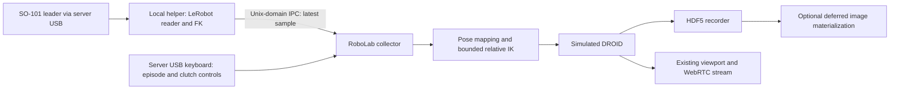

# SO-101 USB Leader Collection Plan

Date: 2026-09-15

Status: Implemented on 2026-09-17; hardware commissioning remains pending. See [SO-101 Leader Teleoperation](so101_teleoperation.md) for the current commands and behavior. The design below is retained as implementation context. The helper uses a mesh-free URDF forward-kinematics evaluator; faults end the collector and require a restart.

## Objective and confirmed setup

Collect demonstrations for the existing simulated DROID arm by moving a real SO-101 leader connected **directly to the RoboLab server by USB**. Keep the current task environments, relative IK action format, success detection, recording, and deferred image workflow.

The leader supplies arm motion and gripper input. A USB keyboard connected to the server supplies episode, clutch, and inset controls through Linux evdev. Wi-Fi carries the scene stream and normal WebRTC signaling; the collector does not consume remote keyboard teleoperation events. An explicit terminal-control option is also available; an SSH terminal would carry its key events over the network.

The revision removes the operator-side hardware client and remote motion connection. A local helper process reads USB and computes leader pose; the collector consumes its latest sample through local IPC. A physical follower and a simulated SO-101 are outside this proposal.

## Findings from the existing implementation

| Component | Relevant behavior |
| --- | --- |
| [Keyboard collector](../examples/collect_keyboard_demos.py) | Configures one DROID environment, recording, rendering, pacing, episode starts, retries, and cleanup. Several names and metadata fields currently identify the keyboard collector explicitly. |
| [Relative IK configuration](../robolab/robots/droid.py) | `DroidRelIKActionCfg` controls the gripper mount `base_link` in robot-root coordinates and scales the six arm commands by `0.5`. The rotated `body_offset.rot` is commented out in the inspected configuration. |
| [Frame contract](frames.md) | Cartesian actions use robot-root axes. RoboLab pose quaternions use `(w, x, y, z)`. The `ee_*` and rotated `eef_*` observations describe different frames. |
| [Relative IK registration](../robolab/registrations/droid/auto_env_registrations_rel_ik.py) | Uses 120 Hz physics with eight substeps per action, giving 15 Hz control. Supports disabling policy cameras for deferred collection. |
| [Attempt controls](../robolab/core/teleop/lifecycle.py) | Separates waiting for a start from recording and rejects stale retry requests. It currently has no clutch or input-fault state. |
| [Recorder terms](../robolab/core/events/basic_recorders.py) | Records raw environment actions and observations before each step, and scene states after each step. |
| [Deferred materializer](../robolab/core/replay/materialize.py) | Reconstructs observation images from the initial state and preceding post-step states. Depends on collection metadata and the adjacent `env_cfg.json`. |
| [Project dependencies](../pyproject.toml) | Already include ZeroMQ, MessagePack, NumPy, and SciPy. The inspected simulator environment has Isaac Lab 2.2.0 and no LeRobot hardware integration. |

The installed Isaac Lab implementation interprets relative rotation as an **axis-angle rotation vector**, despite some configuration comments describing roll/pitch/yaw. The action remains:

```text
[dx, dy, dz, rx, ry, rz, gripper]
```

The first six values are raw commands before the action term applies its scale. The gripper is `0=open`, `1=closed`.

LeRobot exposes five SO-101 arm readings (`shoulder_pan`, `shoulder_lift`, `elbow_flex`, `wrist_flex`, `wrist_roll`) and a separate gripper reading. Its reader returns named `.pos` values; the gripper uses 0–100 normalization. Connection configures the leader with torque disabled for manual movement. [LeRobot leader implementation](https://github.com/huggingface/lerobot/blob/main/src/lerobot/teleoperators/so_leader/so_leader.py)

Explicitly set `use_degrees=True` for arm readings instead of depending on the installed version's default. [Leader configuration](https://github.com/huggingface/lerobot/blob/main/src/lerobot/teleoperators/so_leader/config_so_leader.py)

## Architecture



### Local USB helper

Run a standalone helper under a dedicated Python environment containing a pinned LeRobot version, its Feetech dependencies, the chosen forward-kinematics dependency, and IPC support. Keep these dependencies out of the Isaac Sim environment. The helper must not import the RoboLab package or simulator modules; importing RoboLab currently traverses several package initializers.

The collector starts the helper using an explicit Python executable and an argument list. It owns the helper's lifetime, reports startup failures, and closes its process and IPC resources on exit. A diagnostic mode allows checking hardware readings without starting Isaac Sim.

Configuration includes the serial port, leader ID, calibration location, URDF location, and read frequency. Prefer a stable `/dev/serial/by-id/...` device path when available. Only the helper opens the serial port.

Calibration is a separate setup operation using the chosen LeRobot version and consistent device ID. Collection requires a calibration file and matching device calibration; it must fail clearly instead of entering an interactive calibration procedure. Reuse existing calibration when valid. [Official SO-101 setup and calibration](https://huggingface.co/docs/lerobot/so101#calibrate)

Start with a proposed 60 Hz sampling target and measure achievable USB read latency. Use bounded read retries. A failed read never refreshes the timestamp of the previous successful sample.

### Local sample transport

Use ZeroMQ over a Unix-domain `ipc://` endpoint. Both processes run on the server, so no TCP listening port or remote client is needed.

Use versioned, single-message samples with a latest-only buffer. The collector polls without blocking and never drains a history into a burst of actions. Each sample carries:

- Reader session ID and monotonically increasing sequence number.
- Host monotonic timestamps for the read interval.
- Five named arm angles in degrees and the normalized gripper reading.
- Leader end-effector position in meters and quaternion in a declared order.
- Calibration/model identity and validity status, either directly or through session metadata.

Keep startup/error status separate from disposable pose samples. Bound message sizes and validate joint names, numeric finiteness, quaternion norms, session identity, ordering, and sample age. Use the common host monotonic clock; receipt of an old queued sample must not make it fresh.

The simulator remains paced at `env.step_dt`, currently 15 Hz. A faster leader read rate improves sample freshness without changing physics or dataset frequency.

## Mapping SO-101 motion to DROID

### Forward kinematics and calibration

Compute leader pose in the helper using the SO-101 model and a fixed end-effector frame such as `gripper_frame_link`. LeRobot's existing Cartesian teleoperation example uses forward kinematics with `so101_new_calib.urdf`; use that as a reference and pin the selected model revision. [Upstream example](https://github.com/huggingface/lerobot/blob/main/examples/so100_to_so100_EE/teleoperate.py)

Validate encoder calibration against URDF joint directions and zero offsets using known physical poses. Keep the gripper scalar outside the five-joint arm chain; its normalized value must not be interpreted as an arm angle. Record the model checksum and any explicit sign/offset corrections.

### Anchored pose tracking

At each episode start and clutch release, capture a fresh leader pose and the actual current DROID control-frame pose. These define the reference relationship, avoiding a jump to the leader's absolute position.

Let `A` rotate leader-base axes into DROID robot-root axes, `s` be translation gain, and subscript `0` denote the captured references. The proposed target mapping is:

```text
p_target = p_droid_0 + s * A * (p_leader - p_leader_0)
R_delta  = A * R_leader * transpose(R_leader_0) * transpose(A)
R_target = R_delta * R_droid_0
```

Compute the target's position and orientation error relative to the measured DROID `base_link` pose. Convert orientation error to a shortest-path rotation vector in robot-root axes. Apply filtering, deadbands, workspace bounds, and per-step displacement limits, then divide the bounded six-dimensional increment by the configured IK action scale. With the current scalar scale this means dividing by `0.5`.

Read the runtime action configuration and fail on unsupported frame/scale settings. Do not silently use the rotated `eef_quat` observation when the action controls `base_link`.

Holding the leader still holds a fixed target; the robot may continue converging to it, but repeated samples do not accumulate more target displacement. Limit target error as well as individual increments, and pause with a diagnostic when sustained tracking error indicates an unreachable or obstructed target. A per-step limit alone would still allow prolonged pushing toward an unreachable pose.

### Five-degree-of-freedom limitation

Five arm joints cannot independently specify all six Cartesian pose components simultaneously. Provide two explicit modes:

- **Fixed orientation:** Map leader translation and hold the captured DROID orientation. Use this mode for initial pick-and-place validation.
- **Pose following:** Map the leader's attainable position and orientation together. This follows a constrained pose family; it does not provide six independent controls.

Changing mode requires clutching and fresh references. A clutch permits repositioning the leader within its physical workspace. Additional orientation-only controls can be considered after task-level evaluation, if these two modes prove insufficient.

### Gripper mapping

Measure physical open/closed endpoints and convert the leader reading into a closure fraction. Use separate close/open thresholds to produce a binary latch without chatter. For example, `0.65` to close and `0.35` to open are initial tuning candidates, not validated hardware settings.

During pauses, preserve the simulated gripper command. Before starting or resuming, require the physical gripper to agree with that latch so repositioning the leader cannot accidentally release an object. Proportional simulated finger control is outside this first implementation.

## Operator controls and fault behavior

Read controls from the server USB keyboard through evdev. Retain `N` to start, `R` to reject/reset, and `B` to toggle the camera inset. Add a proposed `H` clutch toggle and select the orientation mode through configuration initially. Verify new bindings against Kit before finalizing them. Disable keyboard arm-motion and gripper-toggle bindings in SO-101 mode so inputs cannot compete.

| State or event | Required behavior |
| --- | --- |
| READY | Render and poll input without stepping physics. Start is accepted only with valid calibration, fresh samples, and matching gripper state. |
| Start with `N` | Clear old input, capture references, and begin the attempt. |
| RECORDING | Read the latest valid sample, compute one action, snapshot its diagnostics, and perform one environment step. |
| Clutch engaged | Pause environment stepping and recording while rendering continues. Preserve gripper state and allow physical leader repositioning. |
| Clutch released | Require fresh data and matching gripper state, clear filters, capture new references, and resume without a catch-up command. |
| Sample becomes stale | Pause immediately on detection. Use a configurable initial threshold of 200 ms, to be validated against measured read latency. Fresh data alone never resumes motion. |
| Explicit resume after a brief stale-data pause | Require fresh references and record the interruption in episode metadata. Reset the control pacer's deadline. |
| USB disconnect, helper exit, session change, or invalid calibration | Mark the active attempt failed, finalize/discard it according to `--save-failures`, and require a new attempt after the reader recovers. |
| Success, timeout, or `R` | Use existing finalization/reset behavior, clear mapping state, and require a fresh `N`. |
| Shutdown or exception | Finalize an incomplete attempt as unsuccessful according to the selected failure policy, disconnect the helper, close IPC and recorder handles, and close the simulator. |

Paused wall-clock intervals produce no synthetic action rows and do not advance the episode's simulation-time timeout. Preserve pause events and durations separately for diagnosis. All fault handling is evaluated between control steps; the design cannot interrupt an already executing physics step.

## Collection and dataset integration

Extract reusable configuration, environment setup, recording setup, and episode execution from the keyboard script into a shared collector. Keep imports safe until the Isaac application is launched, preserving the existing OpenCV-before-Isaac import order. Separate motion sampling from episode-control callbacks.

Keep the existing keyboard entry point and its behavior, and add an SO-101 entry point using the same collector. Parameterize policy labels, output paths, filenames, collector identity, and metadata instead of carrying over `keyboard_rel_ik` or keyboard-specific provenance.

Retain successful-demo counting, separate optional failure files, per-attempt seeds, buffered recording, flush/compression settings, real-time pacing, operator inset, and camera settings.

The dataset must contain:

- `actions`: The exact seven-dimensional raw commands passed to `env.step`, after mapping and limits but before the action term's internal scale.
- Existing `obs`, `states`, `initial_state`, end-effector/root poses, task status, seed, and success data.
- A separate `teleop/so101` group with one diagnostic row per recorded action: consumed joint readings, leader pose, gripper reading, sequence, sample age, mapped target, mode, and reference-generation number.
- Session metadata describing software versions, calibration and model checksums, joint order/units, coordinate conventions, mapping settings, actual action scale, sampling target, and timeout thresholds.

Snapshot diagnostics before `env.step` and append them through a pre-step recorder term. This keeps them aligned through success, reset, flushing, and failure export. Do not reread a mutable helper buffer from the recorder. Leader readings are diagnostic inputs, not replacements for simulated robot observations or training actions.

Preserve `robolab_deferred_images` metadata and the adjacent `env_cfg.json`. Materialized observation frame zero must use `initial_state`; frame `t` must use post-step state `t - 1`. The materializer should preserve the added diagnostic group without requiring hardware.

## Proposed file changes

These paths describe the planned decomposition. The implementation also adds so101_options.py, so101_runtime.py, so101_controller.py, and local_controls.py; see the operating guide for actual behavior.

| Path | Responsibility |
| --- | --- |
| `examples/collect_so101_demos.py` | SO-101 collection entry point and device options. |
| `scripts/so101_leader_reader.py` | Standalone USB reader, forward kinematics, diagnostics, and local publishing; no RoboLab imports. |
| `robolab/core/teleop/so101_source.py` | Helper process ownership, IPC reception, sample validation, and freshness tracking. |
| `robolab/core/teleop/retarget.py` | Pure pose mapping, bounds, reference resets, and gripper hysteresis. |
| `robolab/core/teleop/collector.py` | Shared collector setup and execution used by both entry points. |
| `robolab/core/teleop/lifecycle.py` | Explicit clutch/input-pause transitions alongside current attempt controls. |
| `robolab/core/teleop/recorders.py` | Optional aligned SO-101 diagnostic recorder term. |
| `examples/collect_keyboard_demos.py` | Wrapper around shared code while preserving current keyboard behavior. |
| `configs/teleop/so101_droid.yaml` | Versioned mapping, gripper, bounds, and freshness settings. |
| `requirements-so101.txt` | Verified dependency pins for the helper's separate environment. |
| `tests/unit/test_so101_*.py` and collector integration tests | Mapping, transport, lifecycle, dataset, and simulator validation. |
| `docs/so101_teleoperation.md` | Setup, calibration, operation, troubleshooting, and accepted tuning values. |

The URDF and any model assets required by the chosen FK loader need a pinned acquisition path and provenance. Choose a local model location during implementation; collection should not fetch a moving upstream model automatically.

## Proposed usage

The command below illustrates the interface. Device/model paths are placeholders; use the operating guide for server-local keyboard selection and commissioning commands.

```bash
python examples/collect_so101_demos.py \
  --task BananaInBowlTask \
  --leader-port /dev/serial/by-id/YOUR_LEADER \
  --leader-id my_so101_leader \
  --control-device /dev/input/by-id/YOUR_KEYBOARD-event-kbd \
  --leader-python /path/to/so101-env/bin/python \
  --leader-calibration-dir /path/to/calibration \
  --leader-urdf /path/to/so101_new_calib.urdf \
  --teleop-config configs/teleop/so101_droid.yaml \
  --orientation-mode fixed \
  --num-demos 10 \
  --output-dir output/so101_demos/banana \
  --device cpu --livestream 2 \
  --teleop-profile wifi --defer-images \
  --view-layout inset --inset-camera wrist
```

The collector manages the local helper automatically. Add `--no-record` for commissioning without creating demonstration files; its diagnostic output must not be exported as successful task demonstrations. Keep `--no-defer-images` available for live image collection.

## Implementation milestones and acceptance checks

1. **USB diagnostics and model verification.** Select and pin the helper dependencies/model; confirm calibration, all six readings, motor direction, gripper endpoints, known-pose FK, and measured read latency. Disconnect cleanly. No simulator is required.
2. **Shared collector extraction.** Preserve keyboard behavior and run existing lifecycle, pacing, views, recorder, and deferred-image regressions. Update tests such as `test_teleop_benchmark.py`, which currently extract functions directly from the keyboard script, to follow the shared implementation.
3. **Leader-driven simulation without recording.** Implement local sampling, mapping, clutching, and fault handling. Validate both orientation modes. Confirm predictable motion axes, bounded commands, stable targets, unchanged gripper state across pauses, and no jumps at start/reset/resume.
4. **Recording integration.** Add aligned diagnostic terms and provenance. Collect a successful `BananaInBowlTask` demo, exercise failure/retry paths, and materialize deferred images. Verify equal action/state/diagnostic lengths and the pre-step observation alignment.
5. **Operational validation and documentation.** Measure sustained 15 Hz collection in the intended viewport configuration, sample-age distribution, USB read latency, and fault response. Document tested device paths, versions, mapping parameters, and limitations.

Pure tests should cover identity/nonidentity frame alignment, quaternion ordering and sign equivalence, rotation wraparound, the `0.5` scale, repeated stationary samples, bounded target error, gripper hysteresis, reference resets, reordered/duplicate samples, helper restarts, stale timestamps, and cleanup after exceptions. Use a fake monotonic clock for timing behavior.

Simulator tests should verify actual DROID motion in the expected frame, pause/resume without physics advancement during pauses, success/failure export, image materialization, and that `--no-record` writes no demonstration files. Hardware acceptance additionally requires cable-disconnect and reconnect checks: motion must remain paused until the correct explicit start/resume transition.

The first hardware-to-simulation milestone is complete only when the leader controls DROID reliably with recording disabled. Collection is complete only after a real operator demonstration passes recording and deferred-image checks.

## Details to resolve during commissioning

The actual serial device, calibration ID/location and validity, leader assembly/model compatibility, alignment rotation, translation gain, gripper thresholds, workspace bounds, and measured freshness limit remain unknown. These are configuration and commissioning tasks, not reasons to add a remote client or change the simulated robot.

The implementation selects LeRobot 0.4.4 in the separate helper requirements. The upstream `main` links above are research references; the operating guide links the pinned API. Installing the helper environment and validating it against the actual leader remain commissioning steps.
